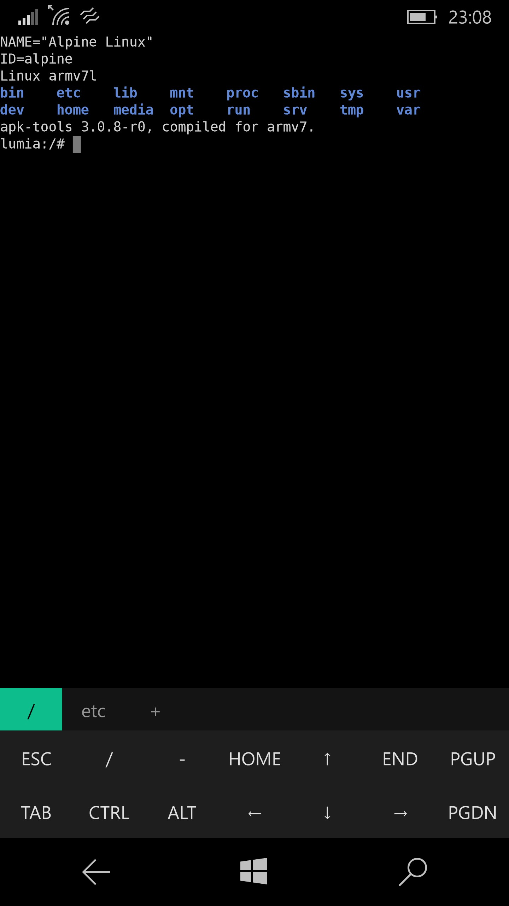

<p align="center">
  
</p>

<h1 align="center">Luminal</h1>

<p align="center">A real Linux terminal for Windows 10 Mobile.</p>

Luminal runs Alpine Linux on a Lumia. Not in a virtual machine and not through an emulator: Alpine's armv7 programs run directly on the phone's CPU, and a small engine translates their Linux system calls into Windows NT ones as they go.

Open the app, run `apk add` whatever you want, and use it.

<p align="center">
  
</p>

## What runs

Everything here has been run on a Lumia 950 (Snapdragon 808, build 15254):

- **Shells and everyday tools:** `bash`, GNU coreutils, `vim`, `tmux`, `htop`, `less`, `git`, `curl`, `lynx`
- **Languages:** Python, Node.js with its JIT and worker threads, `npm`, Ruby, PHP, Perl, Lua
- **Compilers:** `clang` for C and C++, with `make` and `cmake`
- **Networking:** `ssh` and `sshd`, `scp`, `nginx`, `nmap` (connect scans), `ping`, `ip`, `ifconfig`
- **Go programs from Alpine:** `fzf`, `rclone`, `gh`, `caddy`, `restic`, `hugo`, `lazygit`
- **Media:** `ffmpeg`, `yt-dlp`

Most of Alpine's armv7 packages should just work. If one doesn't, that's a bug worth reporting.

## The terminal

- Up to six tabs, each named after the folder it's in
- An extra key row with Esc, Tab, Ctrl, Alt, arrows and page keys
- Pinch to resize the text, swipe to scroll back
- Hold the screen for paste, text selection, text size and colours
- Hold on a link for **Copy link**, which gets the whole link even when it's wrapped across lines
- **Keep awake**, in the same menu: a black screen with one small moving dot, so long jobs keep running without burning in the AMOLED panel. Tap to go back.

Your home folder is `Documents\Luminal`, so you can reach your files from outside the app too.

## Known limits

- **Staying alive in the background.** Windows decides how long the app keeps running after you leave it. I've seen anywhere from a minute to about 46 minutes. Keep awake is the dependable option for anything long.
- **Fixed-address programs can't load.** Programs that must sit at address `0x10000` won't run, because Windows already has that memory. That rules out `gcc`'s own `cc1` (use `clang`, which is also what `cc` should point to) and the Go compiler, along with most prebuilt static Go downloads. Go programs from Alpine's repositories are fine.
- **Raw network access is limited to `ping`.** So `nmap` can do connect scans, but not SYN or UDP scans or OS detection.
- **No IPv6 sockets.** Programs fall back to IPv4.
- **Your home folder is readable by other apps on the phone.** Keep private keys somewhere else, like `/var/lib`, which stays inside the app's own storage.
- **Combining emoji** show as separate glyphs.

## Installing

Your phone needs Developer Mode and Device Portal turned on.

Grab the latest build from [Releases](https://github.com/lumiaw10m/luminal/releases). In Device Portal, install `Luminal.cer` as a certificate, then open **Apps** and install the `.appx` along with the three dependency packages.

The first launch takes a little while, because it unpacks Alpine.

### Building it yourself

You'll need a Windows PC with Visual Studio 2019, the UWP workload, the ARM C++ tools, Windows SDK 10.0.19041 and Python 3.

Fetch Alpine and its C library, which the build packages into the app:

```powershell
python engine\fetch_rootfs.py app\Payload
```

Create a signing certificate. The `-Subject` has to match `Publisher` in `app\Package.appxmanifest`, so change both if you're using your own name:

```powershell
$c = New-SelfSignedCertificate -Type Custom -Subject 'CN=lumiaw10m' -KeyUsage DigitalSignature `
    -CertStoreLocation Cert:\CurrentUser\My -KeyExportPolicy Exportable -HashAlgorithm SHA256 `
    -TextExtension @('2.5.29.37={text}1.3.6.1.5.5.7.3.3', '2.5.29.19={text}')
[IO.File]::WriteAllBytes("$PWD\app\Luminal.pfx", $c.Export('Pfx', ''))
[IO.File]::WriteAllBytes("$PWD\app\Luminal.cer", $c.Export('Cert'))
```

Then build and install it over Wi-Fi:

```powershell
$env:LUMIA_IP = '192.168.1.50'
app\build.ps1 -Install
```

## How it works

Alpine's armv7 programs are Thumb-2 with hard float, which is the same instruction set Windows on ARM uses. So the code can simply run, and the real work is everything around it.

The engine (`engine/tx.c`) loads Alpine's `musl` and patches every system call in it to a trap. When a program traps, an exception handler runs the Linux call using NT's native API. Programs that make their own system calls, like Node and Go, get patched as they load.

A few pieces took more than you'd expect:

- **`fork`** is built directly on `NtCreateUserProcess`
- **Pipes, terminals and sockets** live in memory shared between processes, because each one is a real NT process
- **Go** needed its system calls moved off its tiny goroutine stacks, since Windows writes its exception frame right below the stack pointer
- **Winsock** belongs to one master process, which serves everyone else's sockets

The app itself (`app/`) is a C# UWP project with its own terminal emulator, drawn with Win2D.

## Tests

The engine has its own test suites in `engine/`, which run on the phone through its telnet service. `engine/build.ps1` builds `tx.exe`, a command-line version of the engine that's handy for this. Copy `tx.exe`, `musl.so` and `root.tar` to `U:\tx`, then run `tx.exe import U:\tx\root.tar`. The shell suites and `test3.py` run with `tx.exe -c`, and the interactive ones like `ttytest.py` connect to `tx.exe -L 2323`.

## Credits

Built on [Alpine Linux](https://alpinelinux.org), [musl](https://musl.libc.org), [Win2D](https://github.com/microsoft/Win2D) and [DejaVu Sans Mono](https://dejavu-fonts.github.io).
